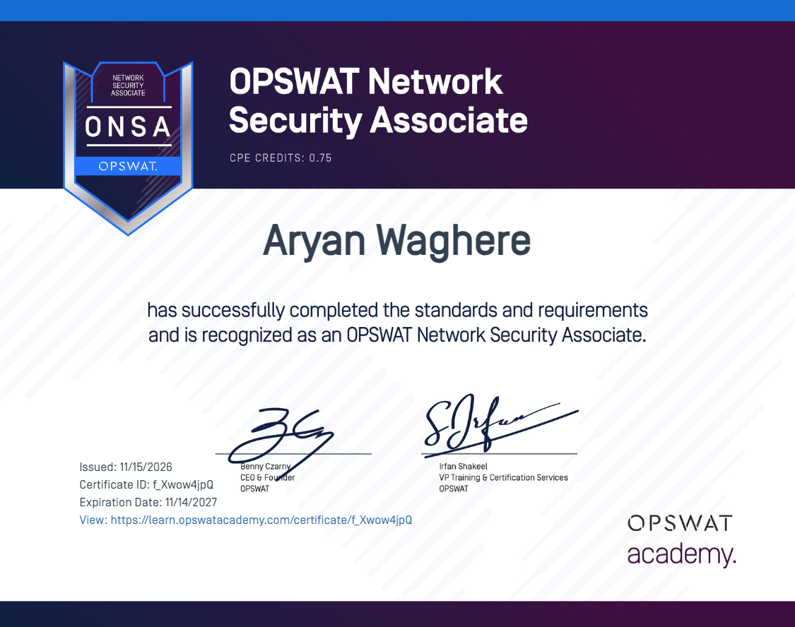

# OPSWAT Academy: Network Security Associate (ONSA)


## What This Is -

This repository documents my study notes and key takeaways from the **OPSWAT ONSA (Network Security Associate)** certification course.

The course is built for IT and security professionals who need to protect critical and enterprise networks. It starts with why unmanaged networks are dangerous, moves into how **Network Access Control (NAC)** identifies and controls every device and user, and ends with how NAC enforces policy and connects with the rest of the security stack.

---

## Course Structure -

The course consists of four parts:
- **Module 1:** Dangers of Unsecured Networks
- **Module 2:** Securing a Network
- **Module 3:** Implementation
- **Final:** ONSA Exam

---

## Key Concepts Covered -

### 1. Dangers of Unsecured Networks

Any network exists so devices can share information, but on an organization's network not every device should be trusted. With users owning and operating multiple network-enabled devices (**BYOD**), an unmanaged network is a serious risk.

> Restricting access to specific resources is critical to securing network assets and protecting data from malicious endpoints.

---

### 2. Why Dirty VLANs Don't Solve the Problem -

A common practice is to send new device connections to a **Guest or Dirty VLAN**. It is quick and simple, but the isolation is logical, not physical.

| Concept | Detail |
|---------|--------|
| **VLAN** | Virtual Local Area Network. A logical group of devices that behave as if on one physical segment |
| **Dirty / Guest VLAN** | Default VLAN for new or unknown devices. Gives internet access without internal access |
| **VLAN Hopping** | Exploit where an attacker on one VLAN gains access to traffic on other VLANs |
| **Switch Spoofing** | Attacking host imitates a trunk switch |
| **Double Tagging** | Attacker adds or modifies tags on Ethernet frames to send packets to any VLAN |

> VLAN Hopping can be prevented with proper switch configuration, but Dirty VLANs still place potential hackers too close to sensitive systems.

---

### 3. North-South vs East-West Traffic -

| Type | Direction | Description |
|------|-----------|-------------|
| **North-South** | External to internal | Connections between different networks through an external router (for example LAN to Internet) |
| **East-West** | Internal to internal | Connections between devices on the same LAN |

Most protection tools focus on North-South traffic. East-West connections are just as dangerous if left unsecured, because malware spreads between devices on the same subnet. No one should get access to a system just by joining a Wi-Fi SSID or plugging into an Ethernet port.

---

### 4. Network Access Control (NAC) -

NAC gives IT administrators control over which devices can connect and what resources they can reach.

| NAC Capability | Description |
|----------------|-------------|
| **Identify** | Devices and users on the network |
| **Assess** | Network information and device compliance |
| **Enforce** | Compose and enforce robust policies |
| **Unify** | Bring existing systems together |

**What NAC can do:**
- Require identification and authorization before any device joins, including IoT endpoints
- Limit users to only the network spaces they are authorized for
- Restrict a location to domain users while offering a separate guest destination
- Remove and quarantine a compromised device in real time

**NAC deployment layers (OSI model):**

| Layer | Works With | Example |
|-------|-----------|---------|
| **Layer 2** | Device hardware data | MAC address |
| **Layer 3** | Logical, changeable assignments | IP address |

Consequences of having no NAC include regulatory fines, license revocations, and breach costs that can be enormous.

---

### 5. Authentication Building Blocks -

| Component | What It Is |
|-----------|-----------|
| **802.1x** | IEEE framework for passing authentication over a wired or wireless LAN. Credentials go to a RADIUS server |
| **RADIUS** | Remote Authentication Dial-In User Service. Broker between a central database (like Active Directory) and the endpoint |
| **Fingerprinting** | Agentless identification of what a device is, using OS, browser type and version, and resources it connects to |
| **Captive Portal** | Browser-based login for non-domain and guest devices. Can require a EULA or guest request form |
| **Device Enrollment** | Users enter credentials plus the MAC address of browserless IoT devices, which ties each device to an owner |

**AAA framework:**

| Component | Question | What It Does |
|-----------|----------|--------------|
| **Authentication** | Who are you? | Checks credentials against a user database |
| **Authorization** | What can you do? | Sets access levels per user or group, enabling network segmentation |
| **Accounting** | What did you do? | Tracks time on network, usage, location, and access point |

> Domain devices authenticate transparently with 802.1x, using the active local user's credentials automatically. Non-domain devices are redirected to a captive portal.

---

### 6. Access Control and Posture Checking -

| Concept | Detail |
|---------|--------|
| **ACL** | Access Control List. Rules that assign network access to newly connected devices. Works like firewall rules and controls inbound and outbound traffic, even inside the same subnet |
| **OECA** | Program whose knowledge is used to judge device compliance before granting access |
| **Posture Checking** | Agent on the endpoint checks AV status, OS patches, and custom items |
| **Custom Checks** | Specific processes, registry keys, or files. The most powerful part of agent configuration |

---

### 7. Enforcement and Quarantine -

**Enforcement by network type:**

| Network Type | Approach |
|--------------|----------|
| **Standard (BYOD allowed)** | Domain devices use transparent 802.1x. BYOD is redirected to a captive portal for registration |
| **Domain only** | Fingerprinting lets domain devices in and bans all other devices |
| **Open IoT / entertainment** | Devices connect freely but sit in an isolated environment through ACLs |
| **Higher security** | Visitors install posture agents. Access only after the device is flagged compliant |
| **Critical networks** | Real-time posture checks. Non-compliant devices are quarantined immediately |

**Compliance responses:**

| Severity | Response |
|----------|----------|
| **Critical** | Immediate quarantine in real time |
| **Moderate** | Non-blocking web message to the user |
| **Low** | Record the failure and act later, no user interaction |

Devices without the agent can be quarantined until it is installed. Self-remediation steps reduce help desk calls.

**Layer 2 vs Layer 3 quarantine:**

| Layer | How It Works | Limitation |
|-------|-------------|-----------|
| **Layer 3** | Routes non-compliant devices to remediation pages | All blocked devices get the same access and can still reach neighbors |
| **Layer 2** | ACLs stop the device from talking to others on the same switch or SSID | True isolation, prevents East-West communication |

> Layer 2 quarantine beats the old Dirty VLAN approach, where quarantined devices could still infect each other.

**Other enforcement points:**
- NAC consumes live feeds from next-gen firewalls and IDS/IPS and quarantines on detection
- **PUA** (Potentially Unwanted Application) detection, such as the **TOR browser**, can trigger Layer 2 quarantine plus guidance for the user

---

### 8. NAC Unification with Security Tools -

NAC collects data from user directories, RADIUS accounting logs, DHCP servers, NetFlow and sFlow collectors, and device fingerprinting. Sharing that data lets other tools see users, not just anonymous IPs and MAC addresses.

| Tool | Benefit From NAC Data |
|------|----------------------|
| **Bandwidth Managers** | Per-user and per-device bandwidth control |
| **Firewalls** | User-specific rules |
| **Identity Access Managers** | Better identity and access decisions |
| **Endpoint Security Systems** | Context for protecting endpoints |
| **Secure Gateways / CASB** | Cloud Access Security Broker. Controls cloud access |
| **Content Filters** | Track and filter by specific user |
| **SIEM** | Security Information and Event Manager. Receives data as syslog, RADIUS accounting, or JSON |
| **IDS/IPS and ATP** | Intrusion Detection/Prevention and Advanced Threat Protection |

---

## Quick Reference -

| Term | Full Form |
|------|-----------|
| **NAC** | Network Access Control |
| **RADIUS** | Remote Authentication Dial-In User Service |
| **AAA** | Authentication, Authorization, Accounting |
| **IEEE** | Institute of Electrical and Electronics Engineers |
| **VLAN** | Virtual Local Area Network |
| **BYOD** | Bring Your Own Device |
| **ACL** | Access Control List |
| **PUA** | Potentially Unwanted Application |
| **CASB** | Cloud Access Security Broker |
| **SIEM** | Security Information and Event Manager |
| **ATP** | Advanced Threat Protection |
| **IDS/IPS** | Intrusion Detection / Prevention System |

**OSI layers, bottom to top:** 1 Physical, 2 Data Link, 3 Network, 4 Transport, 5 Session, 6 Presentation, 7 Application

---

## Real-World Case Study -

| Year | Incident | What Happened | Impact |
|------|----------|---------------|--------|
| **2018** | NASA Jet Propulsion Laboratory | An unauthorized Raspberry Pi sat on the IT network, found by NASA's Office of Inspector General | Undetected for nearly a year. A criminal group reached top secret weapons logistics data |

> A small, low-cost computer was enough. The gap was not a clever exploit, it was that nobody was tracking what connected to the network.

---

## Real-World Relevance -

- **SOC analysts** get far more from alerts when NAC data ties an IP or MAC address to a real user and device.
- **Penetration testers and VAPT teams** can use this to understand what VLAN hopping, flat networks, and unmanaged devices look like from the defender's side.
- **Network and IT administrators** can use ACLs, posture checks, and Layer 2 quarantine to contain a compromised device quickly.
- **Compliance teams** can use NAC accounting and enforcement to show who connected, when, and through what.

---

## Key Takeaways -

After completing this course, you should understand:

1. Why **unmanaged networks** and **BYOD** are real security risks
2. Why **Dirty/Guest VLANs** are not enough, and how **VLAN Hopping** works
3. The difference between **North-South** and **East-West** traffic, and why East-West matters
4. What **NAC** does: Identify, Assess, Enforce, Unify
5. How **802.1x, RADIUS, and AAA** work together
6. Why **fingerprinting** shows what a device is, while RADIUS shows who is connecting
7. How **captive portals and device enrollment** bring IoT devices under accountability
8. How **ACLs and posture checking** control access based on policy and compliance
9. The difference between **Layer 2 and Layer 3 quarantine**
10. How NAC shares data with **SIEM, CASB, ATP, IDS/IPS**, and firewalls

---

## Personal Notes -

> *This section contains my own observations and thoughts from going through the course.*

<!-- Add your personal notes below -->

- The NASA Raspberry Pi case stuck with me. A tiny device went
  unnoticed for almost a year because nobody was tracking what
  connected.

- Dirty VLANs look like a safe quick fix until you learn about VLAN
  Hopping.

- East-West traffic gets ignored a lot. Once someone is inside,
  that is where things spread.

- AAA is simple but it sits under almost all access control:
  who are you, what can you do, what did you do.

- The Layer 2 vs Layer 3 quarantine comparison was the most useful
  part for me. ACLs at the port level actually isolate a device.

- NAC is more than a gatekeeper. It feeds user and device context
  into SIEM, firewalls, and the rest of the stack.

---

## Repository Contents -

```
OPSWAT-Network-Security-Associate/
├── README.md
├── Combined/
│   └── ONSA_Complete_Study_Notes_AllModules.pdf
└── Modules/
    ├── ONSA_Module1_Dangers_of_Unsecured_Networks.pdf
    ├── ONSA_Module2_Securing_a_Network.pdf
    └── ONSA_Module3_Implementation.pdf
```

---

## Resources -

- [OPSWAT Academy](https://learn.opswatacademy.com)
- [RFC 2865: RADIUS](https://datatracker.ietf.org/doc/html/rfc2865)

---

## Certificate -

> OPSWAT ONSA Certification, Issued [November 2026]

<!-- Add your certificate image or link here -->


---

*Notes compiled during active study. Not official OPSWAT material.*
